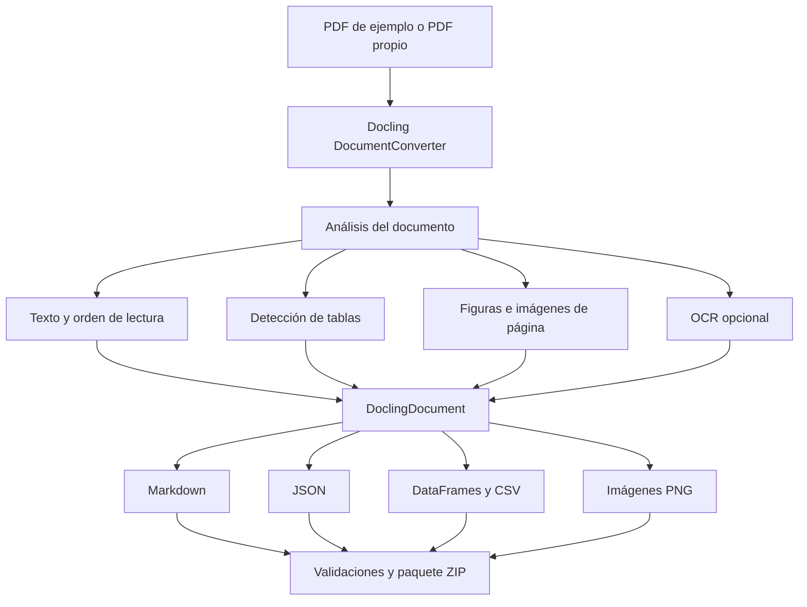

<div align="center">

# 🦙 Tu PDF no es texto
### Document Intelligence con Python, Docling y Google Colab

**Del documento desordenado a la información estructurada que tus aplicaciones de IA sí pueden aprovechar.**

<br>


*Un laboratorio de Document Intelligence para aprender, experimentar y compartir. Porque antes de pedirle respuestas a la IA, también hay que enseñarle a leer bien sus documentos.* ✨

</div>

---

## 👋 Bienvenida/o a este pequeño laboratorio. 

Soy **Orli**, y aquí vamos a meternos con un problema que suele pasar desapercibido cuando construimos aplicaciones con IA: **un PDF no siempre es texto listo para copiar, pegar y enviar a un modelo**.

Un documento puede mezclar párrafos, encabezados, tablas, gráficos, imágenes, notas y páginas escaneadas. Extraer palabras es solo el comienzo; también necesitamos recuperar, en la medida de lo posible, la estructura y las relaciones entre esos elementos.

En este proyecto exploramos **Document Intelligence** con [Docling](https://github.com/docling-project/docling), Python y Google Colab. La idea es aprender haciendo, sin necesitar una API key ni contratar servicios externos para ejecutar el ejemplo.

> 🦙 **La misión:** pasar de un PDF a diferentes representaciones reutilizables —Markdown, JSON, tablas CSV y recursos visuales— y comprobar qué tan bien quedó el trabajo.

## 🎯 ¿Qué vas a encontrar aquí?

Este repositorio reúne dos recursos que se complementan, pero no cuentan exactamente lo mismo:

| Recurso | Para qué sirve | Qué encontrarás |
|---|---|---|
| 📖 **Artículo** | Entender el problema y las decisiones de ingeniería | Conceptos de Document Intelligence, estructura de PDF, OCR, Docling, relación con RAG, limitaciones y buenas prácticas. |
| 🧪 **Notebook de Colab** | Llevar los conceptos a la práctica | Código ejecutable para generar un PDF de prueba, procesarlo, inspeccionar sus elementos, exportar resultados y realizar validaciones básicas. |

### 📖 Lee primero: el artículo

El artículo explica por qué extraer texto no siempre es suficiente, qué aporta Docling, cómo pensar el flujo documental y qué debemos validar antes de conectar los resultados con una aplicación de IA.

### 🧪 Después: abre el laboratorio

**[Document Intelligence con Python, Docling y Google Colab](./Document_Intelligence_Docling.ipynb)**

El notebook contiene la implementación paso a paso. Puedes abrirlo desde GitHub y llevarlo a Google Colab para ejecutarlo.

---

## 🧠 ¿Qué problema estamos resolviendo?

Un PDF está pensado para conservar la apariencia de una página. Eso no significa que su contenido esté organizado como un documento semántico con títulos, párrafos, filas y columnas perfectamente identificados.

Un extractor tradicional puede recuperar texto, pero también puede:

- mezclar el contenido de dos columnas;
- separar una cifra del encabezado al que pertenece;
- perder la relación entre las celdas de una tabla;
- ignorar el orden lógico de lectura;
- no reconocer texto dentro de una página escaneada;
- recuperar una imagen sin comprender qué representa.

**Document Intelligence** busca convertir documentos heterogéneos en información estructurada que otros sistemas puedan inspeccionar y utilizar. No es magia ni garantiza una interpretación perfecta: es una etapa de procesamiento que debemos configurar, evaluar y validar.

## 🏗️ ¿Cómo funciona el laboratorio?

El flujo general de esta demostración es:



### 🧰 Tecnologías

| Tecnología | Papel dentro del proyecto |
|---|---|
| [Python](https://www.python.org/) | Lenguaje principal del laboratorio. |
| [Docling](https://github.com/docling-project/docling) | Convierte documentos y conserva una representación estructurada. |
| [Google Colab](https://colab.research.google.com/) | Entorno alojado donde ejecutamos el notebook. |
| [Pandas](https://pandas.pydata.org/) | Inspección y exportación de tablas como DataFrames y CSV. |
| [ReportLab](https://www.reportlab.com/) | Generación del PDF sintético utilizado como muestra. |
| [Matplotlib](https://matplotlib.org/) | Creación del gráfico que insertamos en el PDF de prueba. |

**Versiones del ejemplo:** el notebook fija `docling==2.151.1` y solicita Python 3.10 o superior. Las demás dependencias se instalan desde la celda inicial. La versión está fijada para hacer más reproducible el ejercicio; antes de actualizarla, revisa los cambios de Docling y vuelve a probar el flujo completo.

---

## 🚀 Cómo ejecutar el notebook

### Opción recomendada: Google Colab

No necesitas configurar un entorno local para seguir el laboratorio.

1. Abre [`Document_Intelligence_Docling_Colab.ipynb`](./Document_Intelligence_Docling_Colab.ipynb) desde GitHub.
2. Selecciona **Open in Colab** o descarga el archivo y súbelo a [Google Colab](https://colab.research.google.com/).
3. Ejecuta las celdas en orden, desde el principio.
4. Espera a que Docling instale sus dependencias y prepare los modelos necesarios. La primera conversión puede tardar más por las descargas iniciales.
5. Revisa los archivos generados en el panel de archivos de Colab. Al final, el notebook prepara un ZIP con los resultados y trata de iniciar su descarga.

### ¿Qué ocurre al ejecutarlo?

Por defecto, el notebook **genera su propio PDF ficticio**. El documento de prueba incluye texto en español, una tabla de indicadores y un gráfico. Sus cifras son inventadas y solo sirven para practicar.

Esto permite ejecutar el ejercicio sin buscar un PDF externo y observar qué elementos puede recuperar Docling.

### ¿Quieres probar con tu propio PDF?

En la sección de selección de documento del notebook encontrarás:

```python
USE_MY_PDF = False
```

Cambia el valor a `True` y ejecuta esa celda. Colab abrirá el selector para subir un PDF. El resto del flujo utilizará el archivo seleccionado.

**Privacidad, muy en serio:** Colab ejecuta el código en un entorno alojado. No cargues contratos, documentos personales, expedientes, informes internos ni archivos confidenciales si no tienes autorización y no has revisado las condiciones aplicables. Para el primer recorrido, utiliza el PDF sintético incluido en el notebook.

---

## 🔬 ¿Qué hace el notebook?

| Paso | Qué ocurre | Resultado esperado |
|---|---|---|
| 1. Instalación | Instala Docling y librerías auxiliares. | Entorno preparado. |
| 2. Imports | Carga las herramientas para PDF, análisis y exportación. | Componentes disponibles. |
| 3. PDF de muestra | Genera un documento con texto, tabla y gráfico. | `informe_comunidad_demo.pdf`. |
| 4. Selección | Escoge el PDF de prueba o uno que subas. | Archivo listo para procesar. |
| 5. Configuración | Define OCR, tablas e imágenes de página. | Pipeline de Docling configurado. |
| 6. Conversión | Ejecuta `DocumentConverter`. | Un `DoclingDocument` para inspeccionar. |
| 7. Inspección | Recorre elementos y orden de lectura. | Vista de los elementos detectados. |
| 8. Exportación | Genera Markdown y JSON. | `documento_extraido.md` y `documento_estructurado.json`. |
| 9. Tablas | Convierte tablas a DataFrames y CSV. | `tabla_*.csv`. |
| 10. Imágenes | Guarda imágenes de páginas, figuras y recortes de tablas cuando están disponibles. | Archivos PNG. |
| 11. Validación | Comprueba contenido, lectura del JSON y CSV generados. | Validaciones básicas completadas. |
| 12. Descarga | Empaqueta los resultados. | `resultados_docling.zip`. |
| 13–15. Ampliación | Explica OCR, problemas frecuentes y próximos pasos. | Pistas para experimentar. |

### 📦 Archivos que genera

En el entorno de Colab, los principales resultados quedan en `/content/resultados_docling/`:

```text
resultados_docling/
├── documento_extraido.md
├── documento_estructurado.json
├── tabla_1.csv
├── figura_1.png
├── tabla_visual_1.png
└── pagina_1.png
```

Los nombres de los CSV y PNG dependen de los elementos que Docling detecte. Por eso, la lista anterior es ilustrativa: un documento puede generar varias tablas, figuras o páginas, o no contener alguno de esos elementos.

El notebook también crea el PDF sintético y el gráfico fuente en `/content/document_intelligence_demo/`.

---

## 🧩 Algunas ideas clave antes de experimentar

### Extracción no es lo mismo que OCR

- **Extracción de texto:** recupera la capa textual que ya existe en un PDF digital.
- **OCR:** intenta reconocer caracteres a partir de imágenes, por ejemplo, páginas escaneadas.
- **Comprensión documental:** interpreta la función y las relaciones entre elementos —qué es un título, qué valores pertenecen a una tabla o cómo se organiza el contenido—. Detectar una imagen no significa comprender automáticamente el gráfico que contiene.

En el notebook `USE_OCR = False` es el valor inicial porque el PDF sintético tiene texto digital. Para experimentar con escaneos, activa `USE_OCR = True` y vuelve a ejecutar la configuración y la conversión. El resultado depende de la calidad del original y de la configuración del motor OCR.

### ¿Esto ya es un RAG?

Todavía no. Este proyecto se concentra en la **preparación documental**, una etapa previa que puede alimentar un sistema RAG. Para construir el RAG habría que añadir, entre otras cosas, segmentación (*chunking*), metadatos y referencias de origen, embeddings, almacenamiento/índice y recuperación. Después habría que evaluar la calidad de los fragmentos y de las respuestas.

### ¿Docling interpreta todos los gráficos?

No debemos asumirlo. El notebook puede guardar figuras o imágenes de páginas, pero extraer un gráfico como imagen no equivale a recuperar sus datos ni explicar sus tendencias. Para eso puede hacer falta una fuente tabular original, un proceso de extracción específico o un modelo multimodal, con validaciones adicionales.

---

## ⚠️ Limitaciones y buenas prácticas

- **Comprueba el resultado contra el PDF original.** La detección de texto o tablas puede equivocarse, especialmente con celdas combinadas, columnas estrechas, páginas inclinadas o escaneos de baja calidad.
- **Mantén la trazabilidad.** Conserva el documento fuente y, en un proyecto real, registra página, versión del procesador y configuración utilizada.
- **Evalúa con documentos representativos.** Un PDF digital sencillo no representa todos los informes, formularios o documentos escaneados.
- **No confundas validación técnica con exactitud semántica.** Que un JSON se pueda abrir o un CSV tenga filas no demuestra que sus valores sean correctos.
- **Ten en cuenta los recursos.** Los modelos, imágenes de página y documentos extensos pueden consumir memoria, almacenamiento y tiempo de procesamiento.
- **Protege los documentos.** No subas información sensible a un entorno alojado sin autorización y una revisión de privacidad.
- **Fija las versiones.** Antes de actualizar dependencias, vuelve a ejecutar el notebook completo con documentos de prueba.

Este laboratorio es educativo. No es un sistema de extracción certificado ni debe utilizarse sin controles en procesos legales, financieros, médicos o de otra naturaleza crítica.

---

## 🗂️ Estructura del repositorio

```text
.
├── README.md
├── LICENSE
├── .gitignore
├── resultados_docling.zip
└── Document_Intelligence_Docling.ipynb
```

Los resultados se generan en el entorno de Colab y no forman parte del repositorio. El `.gitignore` ayuda a evitar que se suban por accidente documentos privados, archivos temporales, entornos virtuales y resultados generados.

---

## 🛣️ ¿Qué sigue?

Este laboratorio es el primer tramo del camino. Algunas extensiones posibles:

- [ ] Comparar resultados con PDFs de distintos diseños y niveles de calidad.
- [ ] Añadir un conjunto de evaluación con resultados esperados.
- [ ] Conservar metadatos y referencias de página en cada fragmento.
- [ ] Explorar *chunking* para documentos estructurados.
- [ ] Construir un índice de búsqueda y conectar la extracción a un RAG.
- [ ] Evaluar la recuperación y las respuestas antes de llevar el flujo a producción.

La idea no es meter IA en cada paso porque sí. Es elegir la herramienta adecuada, medir lo que hace y mantener a una persona en el circuito cuando el resultado importa. 😉

## 📚 Documentación y recursos

- [Docling — sitio oficial](https://docling-project.github.io/docling/)
- [Docling — Quickstart](https://docling-project.github.io/docling/getting_started/quickstart/)
- [Docling — Installation](https://docling-project.github.io/docling/getting_started/installation/)
- [Docling — Pipeline options](https://docling-project.github.io/docling/reference/pipeline_options/)
- [Docling — Export tables](https://docling-project.github.io/docling/_generated/examples/export_tables/)
- [Docling — Export figures](https://docling-project.github.io/docling/_generated/examples/export_figures/)
- [Docling — GitHub](https://github.com/docling-project/docling)
- [Docling 2.151.1 — PyPI](https://pypi.org/project/docling/2.151.1/)
- [Google Colab](https://colab.research.google.com/)

## 💬 Comparte lo que construyas

¿Probaste el notebook con un documento de dos columnas? ¿Qué tal se portó Docling con tus tablas? ¿Encontraste un caso en el que el OCR necesitó ayuda?

Comparte tus observaciones, errores y mejoras. Los laboratorios se vuelven mejores cuando dejamos de experimentar en solitario y aprendemos en comunidad.

**Construimos. Aprendemos. Compartimos.** 🦙

---

<div align="center">

Hecho con curiosidad, Python y un cafecito ☕ por **Orli**.

*La tecnología también se construye compartiendo.*

</div>
